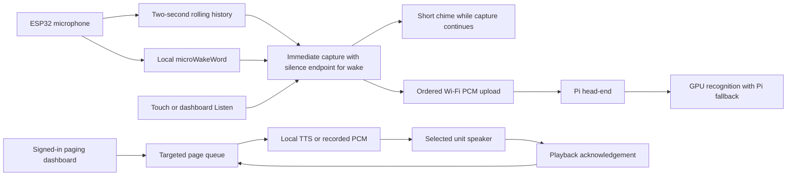

# Local voice and paging head-end

In a typical household deployment, the head-end runs on a headless Raspberry Pi
at `http://<headend-ip>:8765` (for example `http://192.168.1.50:8765`), talking
to Home Assistant at `http://homeassistant.local:8123` (or `<ha-ip>:8123`) and an
optional LAN GPU model host at `<gpu-host-ip>` (for example `192.168.1.20`).
Conversation and speech recognition each have independent local Pi fallbacks,
while Piper speech synthesis runs on the Pi. See
[Raspberry Pi deployment](../deploy/pi5/README.md) and
[conversation routing](CONVERSATION.md).

For local Windows development, start a standalone head-end instance from the
repository root:

```powershell
.\tools\start_headend.ps1 -Lan -OpenBrowser
```

That development dashboard opens at **http://127.0.0.1:8765**. Paired speakers
continue polling their configured server address until explicitly re-paired.
Create the initial administrator account from `localhost` (or via an SSH port
forward); subsequent visits sign in with that account. The USB/audio diagnostic
bench is at **/bench**.

Live voice processing continues even if the diagnostic clip library reaches its
48-clip / 64 MiB limit or a diagnostic clip write fails, because live sessions
are transcribed directly from memory. The separate
[training archive](TRAINING_ARCHIVE.md) preserves complete original interactions,
persistent transcripts and review labels under its own storage budget.
Diagnostic-library or training-archive limits do not block weather answers or
[Home Assistant commands](HOME_ASSISTANT.md); manual uploads on `/bench` still
enforce the diagnostic clip limits.

## Implemented behavior

- Answers wake-triggered weather questions such as **“Hey Adam, what's the
  weather in Seattle, Washington?”** using local speech synthesis and targeted
  device playback. The signed-in **Information & sources** page (`/queries`)
  configures saved locations/aliases, units, reply voice and enabling/disabling.
  Open-Meteo supplies current, today and tomorrow forecasts; geocoding and weather
  lookups use HTTPS while audio and speech stay local. See
  [INFORMATION_QUERIES.md](INFORMATION_QUERIES.md) for privacy, limits and extension points.
- Registers and names speaker units, pairs a connected unit over USB, and stores
  its device identity and server URL in NVS while keeping saved Wi-Fi credentials intact.
- Ends wake questions automatically after **1.2 seconds of quiet**, with a
  13-second post-trigger cap and two seconds of pre-roll. Capture starts immediately
  at the trigger. **Settings → Voice → Talk 8S** and dashboard **Listen 8 sec**
  retain a fixed eight-second diagnostic window. The head-end keeps its local
  speech models warm; see [RESPONSE_LATENCY.md](RESPONSE_LATENCY.md).
- Detects **Hey Adam** locally on the ESP32-S3 using the embedded
  `hey_adam-20261030-c60f0456` microWakeWord model (with stock `Hey Jarvis`
  preserved under `vendor/wake/` for reference/rollback). See
  [HEY_ADAM_PILOT.md](HEY_ADAM_PILOT.md).
- Plays a short embedded **120 ms two-note chime** (`peak: 1000`, reduced by
  20 dB in Firmware v23+ to prevent pre-roll clipping) while capture continues
  and the upload connects. Listening renders translucent green ripple mist over
  the live weather sky; speaker playback renders blue mist. A steady perimeter
  glow ring indicates whether the preferred GPU or Pi fallback LLM is ready
  (Firmware v24–v27). Tapping the center of the screen cancels an active session.
  See [SPACE_PANEL.md](SPACE_PANEL.md). Because acoustic echo cancellation is not
  enabled, saved recordings retain the wake phrase and any chime bleed during pre-roll.
- Streams audio to the head-end during capture and starts configured recognition
  once the session completes cleanly, rather than emitting speculative partial
  transcripts mid-utterance.
- Sends typed announcements (synthesized locally with a selected Piper ONNX voice)
  or recorded/uploaded WAV voice pages to one or more targeted units.
- Provides a signed-in **Voices** library (`/voices`) seeded with Basic English /
  Kristin, supporting versioned voice ZIP imports, audio previews and a persistent
  default voice. Model format, trust limits and export steps are documented in
  [VOICE_PACKAGES.md](VOICE_PACKAGES.md).
- Bounds pages to 15 seconds with a **five-minute** expiry before playback starts.
  A page is marked **Delivered** only when the target unit acknowledges completing
  playback.

## Architecture



Each unit polls the head-end, providing a single routing point for announcements,
weather answers, Home Assistant confirmations and conversational replies.
Completed wake transcripts check the weather handler and Home Assistant command
resolver first; unmatched general questions route to the conversation service.
The LLM has no action tools or Home Assistant credentials. Manual Listen sessions
and archive retranscriptions never dispatch commands or spoken answers.

### Device protocol v1

Devices authenticate with a per-unit Bearer key. A device key cannot access
administrator endpoints or another unit's audio/pages.

| Endpoint | Purpose |
| --- | --- |
| `GET /api/units/{id}/poll` | Heartbeat/capability report; receive Listen or a page offer |
| `POST /api/units/{id}/audio` | Live ordered PCM upload, then return clip/job IDs |
| `GET /api/units/{id}/pages/{page}/audio` | Fetch the offered page's raw PCM |
| `POST /api/units/{id}/pages/{page}/ack` | Acknowledge playing, delivered, or failed |

Poll responses include optional `panel` metadata: Unix time, UTC offset,
configured location, temperature unit, optional `device_name`, weather state
(temperature, WMO condition code and observation time when ready), and
`llm_provider` (`remote`, `local`, `unknown`, `unavailable`, or `disabled`).
Firmware v24–v27 uses `llm_provider` to render the persistent LLM availability
ring without requiring a voice session. Background workers refresh weather and
Ollama model readiness independently so device polls never block on external I/O.
See [SPACE_PANEL.md](SPACE_PANEL.md) for freshness and offline rules.

Upload headers identify the session, trigger (`touch` or `wake`), installed wake
model ID, and frame bound. Each binary packet contains a little-endian 32-bit
sequence number followed by **640 bytes (20 ms of 16 kHz, signed 16-bit mono PCM)**.
Wake sessions use HTTP chunked transfer with `X-Audio-Mode: silence-v1` and an
explicit end record; see [variable-length upload](RESPONSE_LATENCY.md#variable-length-upload).
`X-Audio-Preroll-Ms` reports the prepended history duration (0–2000 ms in 20 ms
steps; absent means zero). The server rejects prefixes that consume the entire
upload and retains the complete waveform in both the training archive and STT input.

The server enforces packet ordering, byte length, duration and a 20-second
wall-clock upload timeout. Missing/duplicate frames, cancellation, disconnect or
capture overruns invalidate the session so damaged audio is never transcribed or
saved as a valid interaction.

On the ESP32-S3, the microphone worker never performs network I/O. Two 64,000-byte
history banks and a 416,000-byte live spool occupy 544,000 bytes of PSRAM. At a
trigger, swapping history banks freezes the two-second prefix without a large copy
while new 10 ms blocks append to the live spool. Previous speaker playback is
excluded from idle history, and wake inference pauses during capture/playback plus
a brief post-playback cooldown to avoid self-triggering.

### Account, queue and storage

Administrator passwords use salted `scrypt` hashes. Browser sessions use
`HttpOnly`, `SameSite=Strict` cookies with a 12-hour lifetime and explicit logout.
Only `localhost` may create the initial administrator account. Device keys are
stored hashed on the head-end and provisioned to the ESP32 over USB (`headend config`).

SQLite databases under `headend/data/` store accounts, paired units, settings and
page states. Queued page audio is bounded to 16 MiB total and 16 pending pages per
unit, with up to 32 registered units, four concurrent audio uploads and eight
queued/running transcription jobs. The diagnostic `/bench` clip library is
bounded separately at 48 clips / 64 MiB.

LAN communication uses HTTP (`http://<RFC1918-IPv4>:8765`) for local household
operation. Add TLS termination and device certificate pinning before exposing the
service beyond a trusted home network. Browser microphone capture requires
`localhost` or HTTPS; plain HTTP LAN sessions can still send typed TTS pages or
upload WAV files.

## Replacing or rolling back the embedded wake model

Firmware v27 ships with `hey_adam-20261030-c60f0456` embedded in
`firmware/main/`. Stock `Hey Jarvis` remains vendored under `vendor/wake/` for
reference and rollback. The [Hey Adam training guide](../training/hey_adam/README.md)
and [GPU model generation walkthrough](WAKEWORD_MODEL_GENERATION.md) document the
isolated CPU/GPU benchmarks and microWakeWord training pipeline, while
[HEY_ADAM_PILOT.md](HEY_ADAM_PILOT.md) records the embedded artifact's hashes and
remaining controlled recall/false-accept evaluation.

Wake inference runs natively on the ESP32-S3 via microWakeWord and TensorFlow
Lite Micro over the shared ES7210 I2S stream; idle audio is never streamed to the
server for wake detection. Pinned upstream sources and hashes are recorded in
`vendor/wake/sources.json` and `firmware/dependencies.lock`.

To install a custom microWakeWord v2 manifest and `.tflite` pair:

```powershell
py -3.12 tools/install_wake_model.py path/to/hey_adam.json --id hey_adam-v1
.\tools\idf.ps1 build
.\tools\idf.ps1 -p COM6 flash
```

## Validation

```powershell
.\headend\.venv\Scripts\python.exe -m unittest discover -s headend -t . -q
.\headend\.venv\Scripts\python.exe -m tools.check_voice_runtime
.\headend\.venv\Scripts\python.exe -m tools.check_preroll_device
py -3.12 tools/check_fleet_browser.py
```

Automated server, session, cue, voice, query, Home Assistant, panel and
conversation tests cover authentication, device key scoping, ordered chunked
uploads, pre-roll boundaries, page delivery states, voice package validation,
weather/device routing, and LLM fallback behavior. On-device `headend selftest`
verifies ring-buffer wraparound, frozen-bank stability, delayed reads and gap
detection without disturbing live audio.
