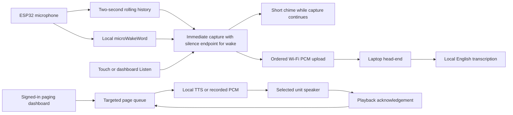

# Local voice and paging head-end

Implemented and tested on October 28, 2026. Start with:

```powershell
.\tools\start_headend.ps1 -Lan -OpenBrowser
```

Open **http://127.0.0.1:8765** on the laptop. The current unit endpoint is
**http://192.168.5.32:8765**. Create the first administrator account on localhost;
subsequent visits use that account. The audio diagnostic UI is at **/bench**.
The server, English recognizer and speech synthesis all run locally.

## Implemented behavior

- Head-end v0.6 answers wake-triggered weather questions, such as **What's the
  weather in Shelton, Washington?**, using local speech synthesis and targeted
  device playback. The signed-in **Information & sources** page (`/queries`)
  configures saved locations/aliases, units, reply voice and enabling/disabling.
  Open-Meteo supplies current/today/tomorrow weather; location lookups and weather
  requests use the internet while speech stays local. See
  [INFORMATION_QUERIES.md](INFORMATION_QUERIES.md) for privacy, limits and extension points.

- Register/name units, pair the connected unit over USB, and keep its device
  identity/server address in NVS. Pairing leaves saved Wi-Fi settings intact.
- Firmware v13 ends wake questions after 1.2 seconds of quiet, with a 13-second
  post-trigger cap and two seconds of pre-roll. Capture starts immediately.
  **Settings → Voice → Talk 8S** and dashboard **Listen 8 sec** retain their
  fixed eight-second diagnostic window. Speech models stay warm on the laptop.
  See [RESPONSE_LATENCY.md](RESPONSE_LATENCY.md) for protocol and measurements.
- The current stock development model recognizes **Hey Jarvis** locally on
  the ESP32. It is explicitly identified as `hey_jarvis-dev-v2`. **Hey Adam is
  the target custom model and has not been trained or tested yet.**
- A short, embedded **120 ms chime** acknowledges the trigger.
  Capture continues while the cue plays and the upload connects. An animated
  ear appears as capture starts; its sound waves
  react to microphone level. Tapping it cancels the session.
  The ear is operator-confirmed; see [cue asset workflow](LISTENING_CUE.md).
  The preserved original audio can contain the wake phrase and the speaker's
  chime. There is no acoustic echo cancellation or automatic removal of
  overlapping speech; recording and transcription both retain the pre-roll.
- Audio reaches the head-end during capture. The dashboard shows progress;
  local transcription starts after the completed session. It does not return
  speculative partial transcripts while the person is still speaking.
- Select one or more units and send typed announcements, synthesized locally by
  a selected Piper ONNX voice, or recorded voice messages. Browser recordings can
  be previewed first. WAV upload is also available.
- The signed-in **Voices** library (`/voices`) includes Basic English / Kristin,
  imports versioned voice ZIPs, generates previews and persists a default.
  Typed pages can override the voice. The model/config/license/checksum format,
  import limits and training/export path are in [VOICE_PACKAGES.md](VOICE_PACKAGES.md).
  Voice weights stay on the laptop; the device's page-audio protocol is unchanged.
- Pages can be up to 15 seconds long. They expire after **five minutes** if
  playback has not started. Delivery means the unit acknowledged completing
  playback; download or a queue entry alone does not count as delivery.

The user confirmed Wi-Fi transcription with animation, clear typed and recorded
pages with Delivered acknowledgements, and a successful on-device wake to
transcription test. Cue/ear validation is recorded separately in
`artifacts/cue-ear-v11-check.json` and the local framebuffer screenshot.

## Architecture



Each unit connects to the head-end. This gives future room-to-room messages
one routing point: the sender identifies the destination room/unit and the
head-end forwards the message. Direct peer discovery or device-to-device
connections are not needed for the first paging version. Future voice intents
can call the same enqueue operation after resolving and authorizing targets.
The transcriber currently executes no smart-home or LLM actions.

### Device protocol v1

Devices authenticate with a unique Bearer key. They cannot use that key to
access the administrator API or another unit's audio/pages.

| Endpoint | Purpose |
| --- | --- |
| `GET /api/units/{id}/poll` | Heartbeat/capability report; receive Listen or a page offer |
| `POST /api/units/{id}/audio` | Live ordered PCM upload, then return clip/job IDs |
| `GET /api/units/{id}/pages/{page}/audio` | Fetch the offered page's raw PCM |
| `POST /api/units/{id}/pages/{page}/ack` | Acknowledge playing, delivered, or failed |

Upload headers identify the session, trigger (`touch` or `wake`), actual wake
model ID, and frame count. Each binary packet contains a little-endian 32-bit
sequence number and **640 bytes: 20 ms of 16 kHz, signed 16-bit mono PCM**.
Firmware v13 wake sessions use chunked transfer and an explicit end record;
`X-Audio-Mode: silence-v1` makes the frame count an upper bound. See
[variable-length upload](RESPONSE_LATENCY.md#variable-length-upload).
Firmware v12 normally sends 500 packets, or ten seconds, including two seconds
of pre-roll; v10/v11 sent 400 packets. `X-Audio-Preroll-Ms` identifies the
prefix (0–2000 ms in 20 ms units); absent means zero for older devices. The
server rejects a prefix that consumes the whole session. Its waveform is
retained in both the saved WAV and the transcriber's input. The packet format
still uses 32,200 bytes/second including sequence numbers, before network overhead.

The server validates ordering, length, duration and session identifiers, with
a 20-second wall-clock limit. Missing/duplicate frames, cancellation, disconnect
or an overrun invalidate a session. Incomplete audio is not saved as a good
clip or transcribed. Valid clips enter the existing local clip library.

The capture worker never performs network operations. Two 64,000-byte history
banks and a 256,000-byte live spool use 384,000 PSRAM bytes. At the trigger,
swapping history banks freezes the prefix without a large copy; each subsequent
10 ms microphone block is appended immediately. A delayed sender reads the
bounded spool without losing the first words. Microphone read errors or RX
overflows invalidate the session and clear history; partial uploads are rejected.
Previous speaker playback is excluded from idle history, while the current
session deliberately retains speech during its cue. The network worker downloads pages into a bounded PSRAM
buffer and keeps it alive until playback ends. Playback/streaming pause local
wake inference; it restarts after a cooldown to avoid hearing its own output.

### Account, queue and storage

Administrator passwords are stored as salted scrypt hashes. Browser sessions
use HttpOnly, SameSite=Strict cookies, expire after 12 hours and can be signed
out. Only localhost can create the initial account. Device keys are stored as
hashes on the head-end and provisioned into the unit over USB.

SQLite under `headend/data/` retains account/device records and page delivery
states. Queued audio is removed on delivery, failure, cancellation or expiry.
There is a 16 MiB aggregate page-audio bound, 16 pending pages per unit, and a
bounded terminal history. The current prototype permits 32 registered units,
four concurrent audio uploads and eight queued/running transcription jobs.
Only **one physical unit** has been exercised; multi-unit routing/isolation
is covered by server tests, not a measured multi-room load test.

The existing clip library is bounded separately at 48 clips / 64 MiB. Saved
clips remain until deleted. Incoming session/transcript history is in memory;
original completed WAVs remain available after a server restart, but that
session history is not yet durable.

This version uses HTTP on the trusted LAN. Login cookies, device keys and
audio are not encrypted in transit. Add HTTPS and device certificate trust
before broader network access. Browser microphone recording works on localhost
or HTTPS; an HTTP LAN visit can still send typed pages or upload a WAV.

## Replacing the stock wake model

The [Hey Adam training investigation](../training/hey_adam/README.md) now includes
pinned upstream sources, a tested isolated CPU benchmark, and a matching GPU
benchmark prepared for the user's RTX 4070 Super machine. A usable Hey Adam
model has not yet been trained or installed.

The engine is native microWakeWord with TensorFlow Lite Micro, using the
existing ES7210 capture stream. It does not own a second I2S driver and does
not upload idle microphone audio for server-side wake detection.

Pinned sources and hashes are in `vendor/wake/sources.json`; component versions
are in `firmware/dependencies.lock`. Source licenses remain with the vendored
files. `micro_wake_word` is GPLv3; the feature extractor and stock model repository
include Apache-2.0 licenses. A target-neutral CRC shim adapts the older runner
to ESP-IDF 5.5.1 without modifying the pinned source files.

To install a genuinely trained compatible custom model:

```powershell
py -3.12 tools/install_wake_model.py path/to/hey_adam.json --id hey_adam-v1
.\tools\idf.ps1 build
.\tools\idf.ps1 -p COM6 flash
```

The matching local `.tflite` bytes, feature step, probability threshold, window,
tensor-arena size and phrase metadata travel together. Changing a manifest's
name does not retrain a stock model. The device validates the streaming model
interface during loading. The head-end accepts the model ID as metadata and
needs no phrase-specific code.

Remaining custom-model work: prepare varied positive examples of **Hey Adam**,
negative and near-miss phrases, train locally, validate held-out speech, then
test intentional detections and background false triggers on this hardware.
The present stock phrase test proves the runtime and transport, not custom
recognition quality or an overnight false-trigger rate.

## Next stages

1. Train and evaluate the actual Hey Adam model on this runner.
2. Add silence-based end-of-speech detection and evaluate acoustic echo
   cancellation. Two-second pre-roll and immediate capture are implemented;
   firmware v13 adds an adaptive silence endpoint with a 13-second cap.
3. Add device groups/room permissions, key revocation and durable transcripts.
4. Add a command router for voice-controlled paging and Home Assistant adapters.
5. Add room-to-room messages through the same queue, then evaluate live intercom
   and acoustic echo control. The current design serializes listening and
   playback on each unit.

## Validation

```powershell
.\headend\.venv\Scripts\python.exe -m unittest headend.test_session headend.test_server headend.test_fleet headend.test_cue headend.test_voices -q
.\headend\.venv\Scripts\python.exe -m tools.check_voice_runtime
.\headend\.venv\Scripts\python.exe -m tools.check_preroll_device
py -3.12 tools/check_fleet_browser.py
```

Thirty-four server/session/cue/voice tests pass, covering login, device scope, ordered
streams, wake metadata, incomplete uploads, resampling, playback state
transitions, cancellation, durable expiry, package rejection, default persistence
and model trust/resource boundaries. Pre-roll tests verify original recording
bytes, the complete transcription input, invalid durations and older clients.
The physical unit passes `headend selftest` for history wraparound, frozen-bank
stability, delayed reads, packet bounds, startup alignment and capture gaps.
The real stream check saves a complete ten-second WAV with no input gaps.
Isolated browser checks pass
login, target selection, typed pages, microphone recording/resampling,
preview playback, logout, voice import/default/removal, per-page voice selection
and mobile layout without console exceptions. Actual Piper API validation is in
`artifacts/voice-runtime-check.json`; it also checks concurrent fleet polling.

Evidence includes `artifacts/fleet-browser-check.json`, `fleet-desktop.png`,
`fleet-mobile.png`, `fleet-hardware-v9.json`, `fleet-hardware-v10.json`, firmware
build/flash logs, and the cue/ear framebuffer/check files.
