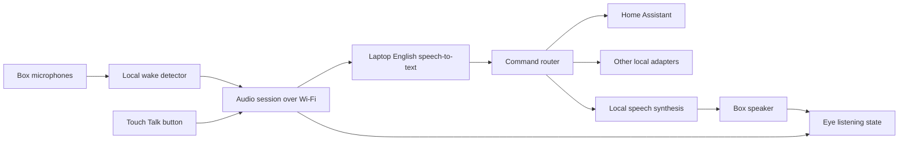

# Local voice device and head-end plan

Working design, October 28, 2026. This document separates measured behavior,
implementation candidates, and acceptance tests still to perform.

Progress: firmware v12 and the local head-end now provide microphone capture,
on-device Hey Jarvis development wake, Wi-Fi streaming, local English
transcription, typed/recorded paging, a listening cue and an animated ear.
Two seconds of on-device pre-roll and immediate post-trigger capture are
implemented, as is a local Piper voice library with model imports/previews.
The operator confirmed streaming, both paging methods and wake-triggered
transcription. See [implemented design](HEADEND_NETWORK.md). Firmware v8's
microphone correction remains in place. The actual custom Hey Adam model
still needs training and hardware validation.

## Agreed requirements

- Keep the animated eye and touch controls usable during audio work.
- Run speech-to-text locally on this Windows laptop, in English, without a
  cloud fallback. Eventually return spoken responses to the box.
- Detect **Hey Adam on the ESP32**, then send command audio to the laptop.
  A stock wake phrase may be used for initial tests only. Validate the custom
  phrase early; it is not a finishing touch after building everything else.
- Control local devices through Home Assistant and additional adapters where
  useful. The intended device mix includes Wi-Fi, Bluetooth and Matter/Thread.
- Neither Home Assistant nor a Thread border router is currently installed.

## What we know

The current firmware plays generated tones/chimes alongside eye animation and
connected Wi-Fi. The user confirmed three clear notes at volume 20. The eye
ran at 18.2–18.3 fps during muted audio processing; playback used about 1.3%
of one core. Total CPU utilization was about 30% across both cores. Roughly
198 KiB internal heap and 7.48 MiB PSRAM remained free. See
[measured capacity](AUDIO_AND_CAPACITY.md).

Those figures do not include microphone capture, a wake model, acoustic echo
cancellation, TLS, speech decoding or sustained network audio. They support
trying the design; they do not prove that all combinations will work unchanged.

This laptop reports an Intel i7-1270P (12 cores, 16 logical processors), about
32 GB RAM and Intel Iris Xe graphics. No NVIDIA GPU was reported. Start with
CPU inference and measure short-command latency while the laptop is in use.
Python 3.12 is available. The isolated head-end environment now has
faster-whisper and a pinned local base.en model, using CPU INT8 inference.

## Architecture

The eye is rendered on the ESP32 throughout. Network messages change its state
(idle, listening, processing, speaking, offline), rather than streaming video
from the laptop. Wake detection produces a generic start-listening event; the
head-end does not require a particular phrase and does not run always-on STT
to simulate an on-device wake word.

Device duties: microphone capture, wake detection, short audio queues, speaker
playback, touch controls and rendering. Laptop duties: transcription, command
routing, optional conversation, speech synthesis, service/device adapters and
diagnostics. An LLM is not required to turn supported lights or switches on.

## Display and audio concurrency

| Combination | Assessment and implementation approach |
| --- | --- |
| Eye + tone | Measured and working; audio worker is separate from rendering |
| Eye + voice playback | Typed and recorded pages tested; bounded whole-message mono PCM buffer in PSRAM |
| Eye/ear + microphone + upload | Eight-second Wi-Fi streams tested while animation remains active |
| Eye + continuous local wake detection | Stock Hey Jarvis runs locally; about 32–33% of core 1, eye about 15–16 fps; custom-model acceptance remains |
| Listening while the speaker replies | Requires echo control and alignment, not just more free RAM |

The V2 has an ES7210 microphone ADC and an ES8311 output codec, with shared
MCLK/BCLK/LRCK on GPIO 2/48/38; microphone data is GPIO 39 and speaker data is
GPIO 47. The vendor advertises two microphones and an echo-reference circuit.
The pinned example allocates TX and RX together, with 16 kHz and 32-bit slots.
Its selection of all four ADC inputs does not prove how the physical signals
map into the returned buffer. Verify the channel order, gain, bit alignment,
and reference wiring before selecting an AEC input format.

The current shared audio-bus owner allocates TX/RX together at 16 kHz with
32-bit stereo slots. Playback feeds silence when idle to keep capture clocks
running. The capture worker converts the upper 16 bits to stereo PCM for
recordings; the head-end selects one channel for recognition. Playback must
not stop or retime these shared capture clocks.
Never run two independent masters on the same shared clock pins. Shared clocks
alone do not guarantee software sample alignment for echo cancellation.

Audio capture/playback workers service DMA promptly; network and rendering
consume queues. A slow network must not block capture or drawing. Count capture
overruns, playback underruns, dropped sessions, queue high-water marks and
task stack minima. Keep DMA/stacks in appropriate internal memory and larger
buffers in PSRAM. The main rendering path must not perform STT, model loading,
blocking network calls or filesystem writes.

Initially use **listen, then reply**: ignore wake detections during reply
playback and resume after the audio tail. Capture clocks can remain active.
Touch Stop remains available. Later test AEC using the actual output/reference
signal and add voice interruption during replies. Avoid self-triggering from
the acknowledgement tone by defining when wake detection resumes.

## Custom wake phrase: early acceptance gate

The preferred candidate is **microWakeWord + TensorFlow Lite Micro**, which has
an open training path for custom phrases and can target ESP32-class hardware.
Its ESPHome integration is a reference, not a component that can be dropped
unchanged into this ESP-IDF application. Budget a native integration test for
its feature extraction, streaming state, supported operators and tensor arena.

Espressif WakeNet is an alternative for quick hardware tests; its stock phrase
support is not proof of a self-service Hey Adam training workflow. Espressif's
documented routes include its customization service and community requests
for vendor-trained TTS models; both depend on external delivery. Keep the wake
engine behind an interface so that choosing an audio front-end does not lock
us into its wake-model format. ESP-SR WakeNet, microWakeWord and openWakeWord
models are different artifacts and are not interchangeable.

Prove these points before building out the complete service/UI:

1. A known compatible model runs continuously on this board with the eye and
   microphone, with measured inference deadlines and heap/stack headroom.
2. A trained **Hey Adam** artifact loads in that same on-device runner and
   actually triggers it. Changing a label in a manifest does not count.
3. Test the user's real voice at normal distance, fast/slow speech and different
   angles, plus background speech/TV and near-miss phrases such as “Hey Alan.”
   Use recordings held out from training. Start with 20 intentional attempts
   at about one metre and aim for at least 18 detections; extend testing after
   tuning. A short demo does not establish a false-trigger rate.
4. Run background listening for several hours, with no continuous audio upload,
   then test a longer overnight run. Log detections/timing, with audio recording
   enabled only for explicit diagnostic samples.
5. Measure model flash size, arena/PSRAM, per-core load and frame rate. A stock
   phrase remains an explicitly labeled development fallback, never a silent
   replacement for the requested phrase.

Training uses varied positive samples, synthetic speech, negative/near-miss
examples, noise augmentation and independent validation. The project warns
that good custom models require experimentation. This laptop's lack of an
NVIDIA GPU may make local training slow; compatibility and training time need
an early check. Runtime stays fully local. Any different training-machine or
external-compute proposal is a separate choice, not an assumed cloud fallback.

## Audio session and service contract

Use 16,000 samples/s, mono signed 16-bit little-endian PCM on the wire:
32,000 bytes/s (256 kbit/s), plus framing. A 20 ms chunk is 640 bytes. Maintain
a rolling two-second/64,000-byte pre-roll on the device so speech immediately
after the wake word is retained. Firmware v12 freezes one history bank and
records eight post-trigger seconds into a separate spool; capture continues
during the acknowledgement. Idle history stays on the device and is overwritten.
Only a touch/wake trigger creates an upload session. Silence-based termination
is still planned; the current implementation permits cancellation and uses a
fixed eight-second post-trigger window, with a 15-second server audio limit.

Proposed device transport: one authenticated WebSocket over the LAN, with JSON
control messages and binary audio chunks. Begin on loopback for PC tests; add
the device-facing listener, paired credential, TLS/certificate handling and a
scoped firewall rule when the firmware client is ready. These are not installed
or activated by the initial skeleton.

Control flow: `hello/capabilities`, `start(session_id, trigger, model_id,
format)`, `ready`, numbered PCM chunks, `end` or `cancel`, `transcript`, then
optional `response/playback` events. Each result references its session.
Use unique IDs, a generation counter for stale responses, one active device
and one transcription job initially, bounded queues and connection/time limits.
Sequence gaps invalidate an utterance; they must not silently create damaged
speech. Cancellation suppresses stale results/actions, even if a CPU inference
job cannot immediately be interrupted.

The first STT provider candidate is faster-whisper **base.en**, CPU INT8, four
threads. Compare **small.en** if command accuracy needs improvement. Keep the
loaded model warm in a worker outside the network event loop. Measure time
from speech end to text, memory, and transcription accuracy; no latency promise
is based on somebody else's CPU benchmark. Provision complete model files
locally and disable implicit downloads in normal operation.

Piper is implemented for local typed paging. The trigger uses a separate short chime.
The versioned voice library and export/import format are in
[VOICE_PACKAGES.md](VOICE_PACKAGES.md). Output is resampled on the laptop to
mono PCM16 at 16 kHz before playback. Automated spoken replies remain planned.
Wyoming adapters can later reuse local STT/TTS with Home Assistant. The custom
device/UI transport and the STT provider interface remain separate.

Default retention: keep audio and text in memory for the active session; no
recording/transcript archive. Diagnostics track lengths, latency, status and
resource use. If the laptop sleeps or the service goes away, show Offline,
end uploads, discard old requests and reconnect. Do not replay stale home
commands when the connection returns. Always-on availability ultimately needs
an awake local host; changing Windows sleep policy is a separate deployment step.

## Local home control

Home Assistant is the proposed device registry/controller, with a separate
adapter interface for additional local APIs or MQTT devices. Verify that each
chosen device exposes local control; Wi-Fi or Bluetooth alone does not ensure
that it does. Map recognized intents to configured device capabilities.

On this Windows development machine, Home Assistant OS in a supported VM is
the documented route. Its address, startup behavior and bridged network need
testing before relying on it for room control. A dedicated always-on host can
replace the laptop later without changing the ESP32 session protocol.

| Device connection | What supplies control |
| --- | --- |
| Local Wi-Fi API/MQTT | Home Assistant integration or an explicit local adapter |
| Bluetooth LE | Supported HA integration and a compatible adapter/proxy; profile radio coexistence if using an ESP32 proxy |
| Matter over Wi-Fi | Matter controller, such as Home Assistant with its Matter service |
| Matter over Thread | Matter controller **plus a Thread border router** providing Thread/IP connectivity |

The ESP32-S3 has no IEEE 802.15.4 radio and cannot become a Thread border router
through firmware. A Thread border router is not itself the Matter controller.
Matter uses Bluetooth for initial commissioning, not its normal command path.
Choose Thread hardware after identifying the first target devices; it is not
needed for the microphone/wake/STT milestones.

## Implementation order and checks

| Stage | Deliverable | Exit check |
| --- | --- | --- |
| 0 — Framework, this change | Agreed plan, bounded audio session core, local STT adapter interface, configuration draft | Six offline contract tests pass; no claim of live transcription |
| 1 — Microphone | Shared I2S driver; tap-to-record short diagnostic clip; level/clipping display | User speaks a prompted sentence; verify channels/clarity and no capture overruns while eye animates |
| 2 — Wake proof | Known model in native firmware, then trained Hey Adam | Actual Hey Adam triggers on this board; record hit/false-trigger/resource results |
| 3 — Local transcription | One device streams triggered PCM to an awake laptop and gets English text | Test a fixed phrase set, latency, cancellation, disconnect and reconnect |
| 4 — Spoken replies | Local TTS and buffered PCM output, eye shows speaking state | No underruns during replies; no self-trigger; touch remains responsive |
| 5 — Device control | Home Assistant setup and first local device adapter | Named test device changes state and reports result; no duplicate action after reconnect |
| 6 — Interruption | AEC/reference alignment and wake/listen during replies | User can interrupt in representative acoustic conditions without speaker echo becoming commands |

Stages 1/2 are the critical early uncertainty; a minimal STT experiment can
run alongside them, but the full backend is not a prerequisite to proving the
custom phrase. For each added subsystem, compare with the v4 resource baseline.
Initial engineering targets: no audio drops/resets, roughly 18 fps eye (flag a
sustained fall below 15), at least 1 KiB stack margin per task under tested
paths, and internal heap minimum above 64 KiB. These are starting thresholds,
not guarantees that any untested workload is safe. Measure worst-case queues
and contiguous blocks as well as totals. Add a model partition after the chosen
artifact's size is known; preserve existing NVS offsets and credentials.

## References checked

- [Waveshare V2 microphone/output hardware](https://docs.waveshare.com/ESP32-S3-Touch-LCD-1.85C)
- [ESP-IDF 5.5.1 I2S shared-clock/full-duplex behavior](https://docs.espressif.com/projects/esp-idf/en/v5.5.1/esp32s3/api-reference/peripherals/i2s.html)
- [microWakeWord training project](https://github.com/OHF-Voice/micro-wake-word)
- [ESPHome on-device microWakeWord implementation](https://esphome.io/components/micro_wake_word/)
- [Espressif TFLite Micro runtime](https://github.com/espressif/esp-tflite-micro)
- [Espressif wake-word customization process](https://github.com/espressif/esp-sr/blob/master/docs/en/wake_word_engine/ESP_Wake_Words_Customization.rst)
- [Espressif community TTS-model request process](https://github.com/espressif/esp-sr/issues/88)
- [ESP-SR AFE and resource benchmarks](https://docs.espressif.com/projects/esp-sr/en/latest/esp32s3/benchmark/README.html)
- [faster-whisper CPU inference and model API](https://github.com/SYSTRAN/faster-whisper)
- [Piper local TTS](https://github.com/OHF-Voice/piper1-gpl)
- [Wyoming speech-service protocol](https://github.com/OHF-Voice/wyoming)
- [Home Assistant Windows installation](https://www.home-assistant.io/installation/windows/)
- [Home Assistant Matter and Thread roles](https://www.home-assistant.io/integrations/matter/)

Library references describe candidate capabilities, not validation on our box.
Pin specific runtime/model revisions when integrating and record their licenses,
hashes, memory consumption and actual test results.
