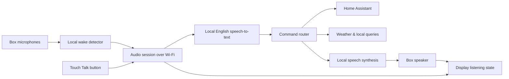

# Local voice device and head-end design plan (historical)

> [!NOTE]
> This document preserves the initial October 2026 architecture and staged bring-up plan written around **Firmware v4–v12** (when STT ran on a single development machine and the unit rendered an animated eye with stock `Hey Jarvis`). Almost all planned stages have since been implemented and superseded by **Firmware v27** and the Raspberry Pi + optional GPU host architecture. For current behavior and setup, see [`README.md`](../README.md), [`HEADEND_NETWORK.md`](HEADEND_NETWORK.md), [`CONVERSATION.md`](CONVERSATION.md), [`SPACE_PANEL.md`](SPACE_PANEL.md), and [`TOUCH_UI.md`](TOUCH_UI.md).

## Original design goals

- Keep display rendering and capacitive touch controls responsive during capture and playback.
- Run English speech-to-text and Piper TTS locally on the LAN without requiring cloud speech APIs.
- Detect **Hey Adam** directly on the ESP32-S3 via microWakeWord + TensorFlow Lite Micro, streaming audio over Wi-Fi only after a local wake or touch trigger.
- Control local smart-home devices through Home Assistant (see [HOME_ASSISTANT.md](HOME_ASSISTANT.md)) using deterministic intent matching rather than giving an LLM direct device credentials.

## Initial baseline assumptions

Early Firmware v4/v12 measurements showed ~30% combined dual-core CPU during
basic display + muted audio output (~50% combined once continuous on-device
microWakeWord inference was added), leaving ~140–198 KiB of internal SRAM and
>6.4 MiB of PSRAM free (see [AUDIO_AND_CAPACITY.md](AUDIO_AND_CAPACITY.md)).

On the head-end side, initial development targeted a standard multi-core x86-64
machine without a discrete GPU using `faster-whisper` (`base.en`, CPU INT8) and
local Piper ONNX synthesis before migrating always-on operation to a Raspberry Pi
with optional LAN GPU offload (see [CONVERSATION.md](CONVERSATION.md) and
[`deploy/pi5/README.md`](../deploy/pi5/README.md)).

## Planned architecture

Device responsibilities: continuous local wake inference, two-second rolling
pre-roll history, silence-ended capture, bounded speaker playback, touch UI and
RGB565 rendering. Head-end responsibilities: authentication, speech recognition,
weather/Home Assistant/conversation routing, Piper TTS synthesis, device
inventory and optional training-archive collection.

## Audio bus and concurrency rules

| Combination | Design approach |
| --- | --- |
| Display + tone/TTS playback | Separate core-1 audio worker feeding DMA; non-blocking UI loop |
| Display + voice page playback | Bounded mono 16 kHz PCM page buffer in PSRAM (up to 15 s) |
| Display + mic capture + Wi-Fi upload | Capture appends to PSRAM spool; separate HTTP task streams ordered 20 ms packets |
| Display + continuous local wake | Native microWakeWord on core 1 (~33% of one core) |
| Barge-in / interruption during replies | Deferred: requires acoustic echo cancellation (AEC) and reference alignment; initial design uses **listen, then reply** (pausing wake during speaker output) |

On the Waveshare V2 board, ES7210 (`0x40`, `DIN` `GPIO 39`) and ES8311 (`0x18`,
`DOUT` `GPIO 47`) share `MCLK 2`, `BCLK 48`, and `LRCK 38`. A single full-duplex
16 kHz, 32-bit stereo I2S owner keeps TX running with silence when idle so RX
clocks never stop or glitch. DMA descriptors and FreeRTOS stacks stay in internal
SRAM while audio spools, page buffers and TFLite Micro arenas use PSRAM.

## Custom wake-word acceptance criteria

1. Run a known streaming microWakeWord v2 model continuously on the ESP32-S3
   alongside display rendering and Wi-Fi with zero I2S or queue overruns.
2. Train and embed an actual quantized streaming **Hey Adam** `.tflite` and v2
   JSON manifest (`tools/install_wake_model.py`), verifying on-device tensor
   allocation and live detections (see [HEY_ADAM_PILOT.md](HEY_ADAM_PILOT.md)).
3. Evaluate live spoken voices across distances (1–3 m), speeds and angles, plus
   near-miss phrases (“Hey Alan”, “Hey Anna”) and multi-hour background audio
   held out from training.
4. Keep stock `Hey Jarvis` vendored under `vendor/wake/` as an explicit rollback
   reference.

## Session and smart-home boundaries

- **Wire format:** 16 kHz mono signed 16-bit little-endian PCM in sequential 20 ms
  (640-byte) packets with sequence numbers and up to two seconds of pre-roll;
  gaps or disconnects abort the utterance rather than transcribing damaged audio
  (implemented over authenticated HTTP polling + chunked `POST /api/units/{id}/audio`
  in [HEADEND_NETWORK.md](HEADEND_NETWORK.md)).
- **Offline safety:** Stale sessions expire rather than replaying delayed smart-home
  actions after a reconnect.
- **Smart-home scope:** Home Assistant serves as the local device controller over
  its REST API. Note that the ESP32-S3 lacks an IEEE 802.15.4 radio; Matter-over-Thread
  devices require a separate Thread border router paired with Home Assistant.

## Staged bring-up checklist

| Stage | Deliverable | Exit check |
| --- | --- | --- |
| 0 — Session core | Bounded session validation, STT adapter interface | Offline contract tests pass |
| 1 — Microphone | Shared full-duplex I2S + ES7210 fix; diagnostic clip capture | Clean speech capture and zero overruns |
| 2 — On-device wake | Native microWakeWord runner + embedded `Hey Adam` model | Continuous inference on hardware with measured RAM/CPU margins |
| 3 — Wi-Fi STT | Pre-roll + silence-ended Wi-Fi streaming to head-end STT | Accurate transcripts, clean cancel/disconnect handling |
| 4 — Spoken replies | Persistent warm Piper TTS worker + targeted unit paging | Sub-second warm synthesis, no playback underruns or self-triggers |
| 5 — Device control | Home Assistant entity inventory, aliases and spoken actions | Verified local device control without duplicate replay |
| 6 — Barge-in (future) | Hardware echo-reference alignment + AEC | Voice interruption during active speaker playback |

## References

- [Waveshare ESP32-S3-Touch-LCD-1.85C documentation](https://docs.waveshare.com/ESP32-S3-Touch-LCD-1.85C)
- [ESP-IDF 5.5.1 I2S full-duplex documentation](https://docs.espressif.com/projects/esp-idf/en/v5.5.1/esp32s3/api-reference/peripherals/i2s.html)
- [OHF-Voice microWakeWord](https://github.com/OHF-Voice/micro-wake-word) and [ESPHome micro_wake_word](https://esphome.io/components/micro_wake_word/)
- [Espressif esp-tflite-micro](https://github.com/espressif/esp-tflite-micro)
- [SYSTRAN faster-whisper](https://github.com/SYSTRAN/faster-whisper) and [OHF-Voice Piper](https://github.com/OHF-Voice/piper1-gpl)
- [Home Assistant Matter & Thread architecture](https://www.home-assistant.io/integrations/matter/)
